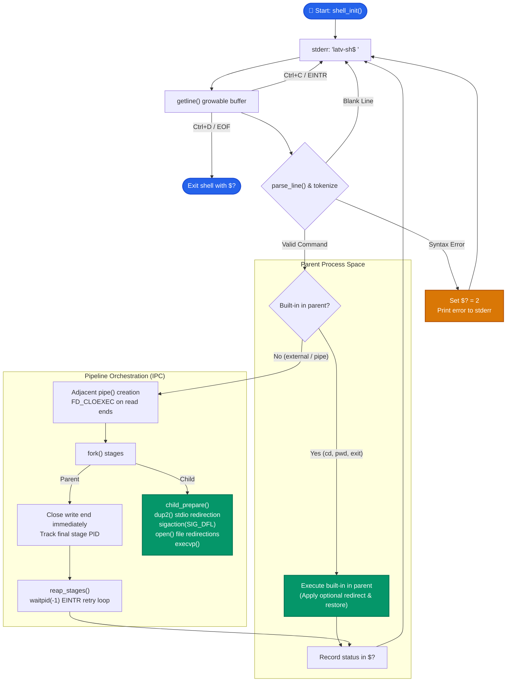
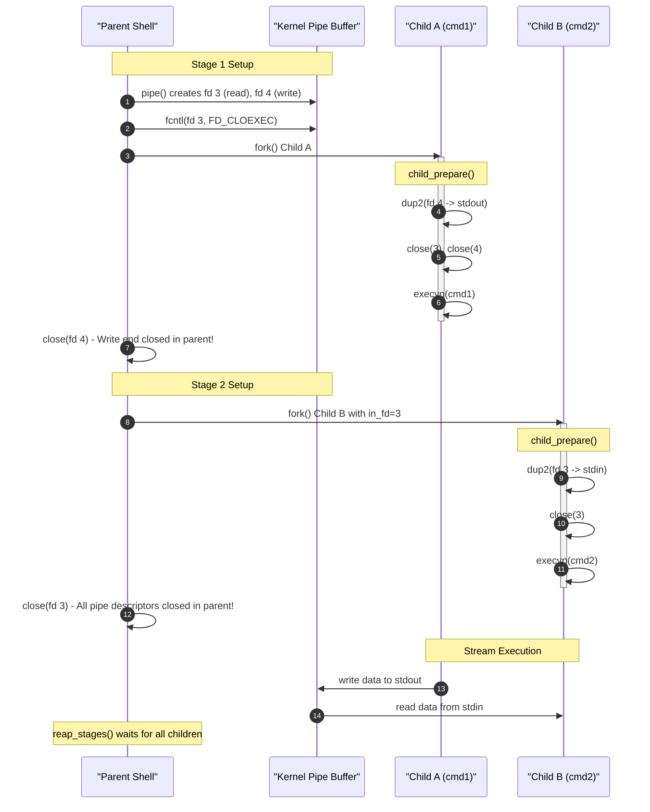
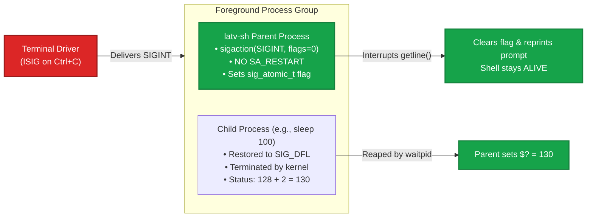

<div align="center">

# `latv-sh`

**A Minimal, Strict POSIX.1-2008 Unix Shell in Pure C99**

[](https://pubs.opengroup.org/onlinepubs/9699919799/)
[](https://en.cppreference.com/w/c/99)
[](Makefile)
[](tests/test_runner.py)
[](LICENSE)

*“Latveria's processes obey. All of them. Always.”*

<br/>

```bash
$ ./latv-sh
latv-sh$ echo "hello world" | tr 'a-z' 'A-Z' | wc -w
2
latv-sh$ exit
$
```

</div>

---

## 🌟 Overview

**`latv-sh`** is an auditable, minimal Unix shell written in compliant POSIX.1-2008 C99.
Implemented as a **single translation unit** (`latv_sh.c`) without any third-party dependencies or libraries beyond standard `libc`.

It is crafted as a deep systems-programming case study in owning the Unix process and stream lifecycle completely:
`fork`, `execvp`, `waitpid`, `pipe`, `dup2`, `fcntl`, `sigaction`, `getcwd`, and `getline`.

---

## 🏗️ Architecture & Lifecyle

### 1. The REPL Interactive Loop



---

### 2. Pipeline Descriptor Plumbing (Deadlock-Free IPC)

For any arbitrary pipeline (`cmd1 | cmd2 | ... | cmdN`), each pipe is initialized immediately before the child that feeds it, and the parent terminates its write ends within the exact same loop iteration:



> [!IMPORTANT]
> **Why write-end closing is the load-bearing invariant:**  
> A pipe signals EOF to reader processes only when **every write-end descriptor is closed system-wide**. If the parent leaks even a single write-end descriptor, downstream readers (`head`, `wc`, `grep`) will block in `read(0)` indefinitely, freezing the entire shell in an unrecoverable deadlock.

---

### 3. Signal Isolation (Parent vs. Child)

Terminal drivers send `SIGINT` (Ctrl+C) to the entire foreground process group. `latv-sh` guarantees strict isolation:



- **Parent:** Uses `sigaction` without `SA_RESTART` so blocking terminal reads (`getline`) are interrupted, the flag is cleared, and the prompt re-appears cleanly.
- **Child:** Explicitly restores `SIGINT` and `SIGQUIT` to `SIG_DFL` before `execvp`. Ignored signal dispositions (`SIG_IGN`) would survive `execve`, making child processes immune to Ctrl+C.
- **SIGPIPE:** Left at POSIX default so infinite generators (`yes | head -1`) are terminated immediately when the consumer closes the pipe.

---

## ⚡ Key Features

| Capability | Technical Implementation |
|---|---|
| **Dynamic REPL** | `getline()` buffer with zero fixed length cap; immune to buffer-overflow attacks. |
| **Quote-Aware Parser** | Supports `'single quotes'`, `"double quotes"`, backslash escapes `\`, and empty string tokens `""`. |
| **Variable Expansion** | In-place expansion for environment variables (`$VAR`) and last exit status (`$?`). |
| **Arbitrary Pipelines** | Chained pipelines of any length (`a \| b \| c \| d`) created via adjacent descriptors. |
| **Stream Redirection** | File input (`<`) and truncated file output (`>`) with safe error rollback. |
| **Built-in Commands** | `cd`, `pwd`, and `exit` executed strictly in parent address space (table-driven dispatch). |
| **POSIX Exit Codes** | `127` (command not found), `126` (permission denied), `2` (syntax error), `128+N` (signals). |
| **Zero Zombie Leaks** | Synchronous count-driven `waitpid(-1)` loop guaranteeing zero `<defunct>` processes. |

---

## 🔨 Build & Quick Start

### Prerequisites
- GCC / Clang with C99 support
- POSIX-compliant environment (Linux, WSL2, macOS, BSD)

### Compilation
Build warning-free under strict standard flags:

```bash
make
```

*Or manually with GCC:*
```bash
gcc -std=c99 -Wall -Wextra -pedantic -O2 -o latv-sh latv_sh.c
```

### Launch Interactive Shell
```bash
./latv-sh
```

---

## 🧪 Automated Test Suite

`latv-sh` ships with an automated test suite (`tests/test_runner.py`) that validates every edge case and POSIX contract:

```bash
make test
```

### Test Suite Coverage:
```text
============================================================
Starting latv-sh acceptance test suite
============================================================
Running Test 1: Builtins cd and pwd (parent execution)... PASS
Running Test 2: Multi-stage pipeline (seq | grep | wc)... PASS
Running Test 3: SIGPIPE and write-end deadlock defense (yes | head -1)... PASS (0.01s)
Running Test 4: Redirection round-trip (<, >)... PASS
Running Test 5: Quotes and variable expansion ($?, $USER, single/double quotes)... PASS
Running Test 6: POSIX exit codes (127 not found, custom exit code)... PASS
Running Test 7: Zombie defense across 50 pipelines... PASS (0 zombies)
Running Test 8: Edge-case syntax errors (unsupported ops, empty pipe stages)... PASS
Running Test 9: Live Demo 4 - Ctrl+C (SIGINT) interruption and status 130... PASS ($? == 130)
============================================================
All 9/9 tests PASSED successfully!
============================================================
```

---

## 💻 Interactive Examples

### 1. Built-in Directory Navigation
Built-ins execute in the parent process, so directory changes persist across commands:
```text
latv-sh$ cd /tmp
latv-sh$ pwd
/tmp
```

### 2. Chained Pipelines
```text
latv-sh$ seq 1 5 | grep 3 | wc -l
1
latv-sh$ printf 'charlie\nalpha\nbravo\n' | sort | head -1
alpha
```

### 3. SIGPIPE Deadlock Defense
`yes` produces infinite output, but terminates instantly (in < 0.02s) when `head` closes the read descriptor:
```text
latv-sh$ yes | head -1
y
```

### 4. Input & Output Redirection
```text
latv-sh$ echo "Doom commands" > /tmp/latveria.txt
latv-sh$ cat < /tmp/latveria.txt
Doom commands
```

### 5. Quoting & Expansion
```text
latv-sh$ echo "user: $USER" '$HOME'
user: masih $HOME
latv-sh$ false
latv-sh$ echo "last exit code:" $?
last exit code: 1
```

### 6. Signal Interruption
```text
latv-sh$ sleep 100
^C
latv-sh$ echo $?
130
latv-sh$ echo "shell is still alive!"
shell is still alive!
```

---

## 📜 POSIX Standards Reference

| Interface | Specification Reference | Purpose in `latv-sh` |
|---|---|---|
| `_POSIX_C_SOURCE 200809L` | [POSIX.1-2008 Headers](https://pubs.opengroup.org/onlinepubs/9699919799/functions/V2_chap02.html) | Exposes `getline`, `sigaction`, and `fcntl` under `-std=c99` |
| `fork()` | [POSIX fork()](https://pubs.opengroup.org/onlinepubs/9699919799/functions/fork.html) | Creates duplicate address-space children |
| `execvp()` | [POSIX execvp()](https://pubs.opengroup.org/onlinepubs/9699919799/functions/exec.html) | Replaces memory image using libc PATH search |
| `waitpid()` | [POSIX waitpid()](https://pubs.opengroup.org/onlinepubs/9699919799/functions/waitpid.html) | Reaps terminated child processes and collects status |
| `pipe()` & `fcntl()` | [POSIX pipe()](https://pubs.opengroup.org/onlinepubs/9699919799/functions/pipe.html) & [fcntl()](https://pubs.opengroup.org/onlinepubs/9699919799/functions/fcntl.html) | Constructs unbuffered IPC channel with `FD_CLOEXEC` |
| `dup2()` | [POSIX dup2()](https://pubs.opengroup.org/onlinepubs/9699919799/functions/dup.html) | Connects pipe descriptors to stdin (0) and stdout (1) |
| `sigaction()` | [POSIX sigaction()](https://pubs.opengroup.org/onlinepubs/9699919799/functions/sigaction.html) | Reliable signal disposition without `SA_RESTART` |
| `getcwd()` | [POSIX getcwd()](https://pubs.opengroup.org/onlinepubs/9699919799/functions/getcwd.html) | Built-in `pwd` resolution directly in parent memory |

---

## 🚫 Non-Goals

Documented upfront for architectural transparency:
- Job control (`&`, `fg`, `bg`, `Ctrl+Z` / `SIGTSTP`)
- Path globbing (`*`, `?`), tilde expansion (`~`), and `$(...)` command substitution
- Complex redirections (`>>`, `2>`, `>&`, heredocs `<<`)
- Line editing (uses raw `getline`, not GNU readline)

---

## 📄 License

This project is licensed under the [MIT License](LICENSE).
